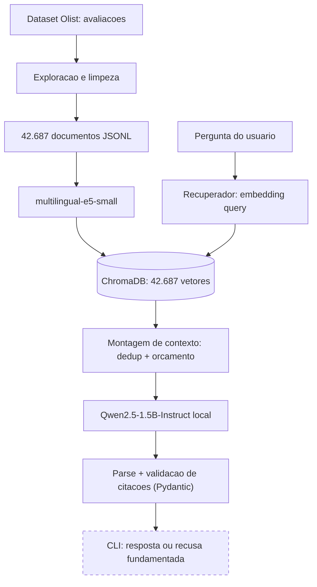

# Voice of Customer Intelligence com RAG

**FIAP POSTECH | Data & AI Scientist | Tech Challenge - Fase 4**

**Versao:** 0.2.0 - RAG basico integrado

**Status:** preparacao, embeddings, indexacao, recuperador reutilizavel,
montagem de contexto e geracao com Qwen2.5-1.5B-Instruct local
implementados e cobertos por testes automatizados com dependencias
falsas. Validacao end-to-end contra o indice completo e os casos de
desenvolvimento do time ainda pendente nesta maquina.

## 1. Sobre o projeto

Este projeto desenvolve uma solucao de Voice of Customer (VoC)
Intelligence utilizando Retrieval-Augmented Generation (RAG).

O objetivo e permitir que usuarios realizem perguntas em linguagem
natural sobre experiencias de consumidores no e-commerce brasileiro
e obtenham respostas fundamentadas em avaliacoes reais.

O projeto utiliza o dataset publico Brazilian E-Commerce Public
Dataset by Olist.

Fonte dos dados:
https://www.kaggle.com/datasets/olistbr/brazilian-ecommerce/data

Exemplos de perguntas que a solucao devera responder:

- Quais problemas de entrega foram relatados pelos clientes?
- Quais reclamacoes envolvem produtos danificados?
- O que os consumidores elogiam sobre suas compras?
- Existem evidencias suficientes para responder a uma pergunta?
- Quais problemas aparecem com maior frequencia na base analisada?

As respostas deverao ser rastreaveis e limitadas ao que os dados
efetivamente sustentam.

## 2. Objetivos

### Objetivo principal

Construir um sistema RAG capaz de recuperar avaliacoes relevantes
e produzir respostas coerentes com o conteudo recuperado.

### Objetivos especificos

1. Selecionar e preparar as avaliacoes textuais da Olist.
2. Estruturar os comentarios como documentos rastreaveis.
3. Gerar embeddings para os documentos.
4. Construir um indice vetorial persistente.
5. Recuperar comentarios relacionados a perguntas em portugues.
6. Selecionar evidencias pertinentes e evitar repeticoes na resposta.
7. Integrar um LLM para gerar respostas fundamentadas.
8. Identificar perguntas sem evidencias suficientes ou fora do escopo.
9. Avaliar a qualidade da recuperacao e das respostas.
10. Documentar as decisoes e permitir a reproducao do projeto.

Os itens 1 a 5 foram implementados e validados.
O item 6 possui experimentos, mas ainda requer validacao integrada.
Os itens 7 a 10 permanecem em desenvolvimento ou validacao.

## 3. Base de dados

A primeira versao utiliza o arquivo:

`olist_order_reviews_dataset.csv`

A selecao inicial foi realizada sobre o conteudo textual das
avaliacoes, combinando titulo e comentario quando disponiveis.

### Perfil dos dados

| Indicador | Quantidade |
|---|---:|
| Avaliacoes originais | 99.224 |
| Avaliacoes com texto aproveitavel | 42.687 |
| Avaliacoes sem texto | 56.537 |
| Documentos somente com titulo | 1.737 |
| Documentos somente com comentario | 31.121 |
| Documentos com titulo e comentario | 9.829 |
| Ocorrencias adicionais de textos repetidos | 5.975 |
| Documentos com ate 3 palavras | 5.778 |

A base textual corresponde a aproximadamente 43% dos registros
originais. Portanto, nao se deve generalizar automaticamente
seus resultados para todas as avaliacoes.

### Perfil de comprimento

- Mediana: 10 palavras por documento.
- Percentil 95: 34 palavras.
- Comprimento maximo observado: 50 palavras.

Foi adotada inicialmente a estrategia de um documento por
avaliacao, sem chunking, devido ao comprimento curto dos textos.

## 4. Arquitetura implementada

O projeto possui atualmente um pipeline de preparacao documental,
geracao de embeddings, indexacao e recuperacao semantica.



**Legenda:** as setas continuas representam o fluxo implementado.
A interface de usuario ainda e uma CLI minima (`src/app.py`); uma
interface grafica permanece pendente.

A descricao detalhada da arquitetura encontra-se em
[docs/arquitetura.md](docs/arquitetura.md).

## 5. Tecnologias

| Componente | Tecnologia |
|---|---|
| Linguagem | Python |
| Manipulacao de dados | Pandas |
| Operacoes numericas | NumPy |
| Modelo de embeddings | intfloat/multilingual-e5-small |
| Biblioteca de embeddings | Sentence Transformers |
| Banco vetorial | ChromaDB |
| Similaridade | Cosseno |
| Reranker experimental | cross-encoder/mmarco-mMiniLMv2-L12-H384-v1 |
| Testes automatizados | unittest |
| Versionamento | Git e GitHub |
| Geracao de respostas | Qwen/Qwen2.5-1.5B-Instruct (local, via transformers) |
| Validacao de saida | Pydantic |
| Interface | CLI minima (`src/app.py`) |

A arquitetura foi desenvolvida inicialmente para execucao local.

## 6. Etapas do desenvolvimento

### Etapa 1 - Exploracao e selecao dos dados

**Status: concluida.**

- Analise do dataset de avaliacoes.
- Identificacao de registros sem titulo e comentario.
- Selecao dos 42.687 registros com texto.
- Preservacao dos identificadores originais.
- Geracao do CSV preparado e do relatorio exploratorio.

### Etapa 2 - Base de conhecimento documental

**Status: concluida.**

- Normalizacao de espacos e caracteres de controle.
- Preservacao de acentos, negacoes e pontuacao.
- Criacao de documentos com `id`, `page_content` e `metadata`.
- Preservacao de notas, datas e identificadores.
- Analise de textos curtos e repetidos.
- Geracao de 42.687 documentos JSONL.

### Etapa 3 - Embeddings e recuperacao vetorial

**Status: infraestrutura concluida; qualidade sob avaliacao.**

- Modelo multilingual-e5-small com embeddings de 384 dimensoes.
- Prefixo `passage:` utilizado para os documentos.
- Prefixo `query:` utilizado para as perguntas.
- Embeddings normalizados.
- Indice vetorial persistente no ChromaDB.
- Colecao piloto com 1.000 documentos.
- Colecao completa com 42.687 documentos.
- Verificacao dos IDs e assinatura SHA-256 da origem.
- Indexacao incremental e possibilidade de retomada.
- Experimentos de reformulacao de perguntas e reranking.

### Etapa 4 - Pipeline RAG e respostas fundamentadas

**Status: versao inicial implementada; validacao end-to-end pendente.**

- Recuperador reutilizavel (`src/retrieval/recuperador.py`).
- Montagem de contexto com deduplicacao e orcamento
  (`src/retrieval/contexto.py`).
- Geracao com Qwen2.5-1.5B-Instruct local (`src/generation/modelo.py`).
- Prompt, parse e validacao de citacoes com Pydantic
  (`src/generation/resposta.py`).
- Orquestracao e CLI minima (`src/app.py`).
- Execucao em lote de casos de desenvolvimento
  (`src/evaluation/executar_casos.py`).
- Tratamento de perguntas fora do escopo e sem evidencias suficientes,
  com status `erro_operacional` reservado para falhas operacionais
  (nunca confundido com ausencia de evidencias).

Pendente: validar contra o indice completo e os 18 casos de
desenvolvimento reais do benchmark da frente de dados (P1), que nao
foram incluidos neste repositorio (ver `data/eval/README.md`).

### Etapa 5 - Avaliacao, interface e entrega

**Status: pendente.**

Atividades previstas:
- Conjunto de perguntas para avaliacao.
- Metricas de relevancia e fidelidade.
- Testes de abstencao.
- Interface para demonstracao.
- README final e instrucao de reproducao.
- Video demonstrativo de ate 7 minutos.

## 7. Principais resultados

A indexacao completa foi executada com sucesso:

- 42.687 documentos carregados.
- 42.687 documentos indexados.
- Embeddings com 384 dimensoes.
- Consultas semanticas realizadas sobre a base completa.

### Experimentos de recuperacao

Foram identificadas falhas na recuperacao de perguntas
sobre problemas de qualidade dos produtos.

Uma reformulacao da consulta, incluindo termos relacionados
a defeitos e danos, melhorou os resultados observados.

Tambem foi testado um reranker multilingual sobre os
50 candidatos inicialmente recuperados.

| Consulta | E5 - Precision@8 exploratoria | E5 + reranker |
|---|---:|---:|
| Problemas de qualidade - original | 12,5% | 75,0% |
| Problemas de qualidade - reformulada | 100,0% | 87,5% |

Esses percentuais foram obtidos por inspecao manual de duas
formulacoes da mesma necessidade de informacao.

**Nao representam a precisao geral do sistema.**

O reranker permanece experimental, pois nao melhorou os
resultados de forma consistente nas duas consultas.

A avaliacao sistematica sera realizada antes da entrega final.

## 8. Estrutura do repositorio

```text
tech-challenge-fase4/
├── data/
│   ├── raw/                  # Dados originais (ignorados pelo Git)
│   ├── processed/            # Dados preparados e JSONL (ignorados)
│   ├── vectorstore/          # Bancos ChromaDB (ignorados)
│   └── eval/                 # Casos de exemplo para a CLI de avaliacao
├── docs/
│   ├── arquitetura.md
│   ├── decisoes.md
│   ├── diario.md
│   ├── etapa2_guia.md
│   └── mapa_requisitos.md
├── notebooks/
├── reports/                 # Relatorios agregados
├── scripts/
│   ├── explorar_avaliacoes.py
│   ├── construir_base.py
│   ├── testar_embeddings.py
│   ├── testar_chromadb.py
│   ├── indexar_base_completa.py
│   ├── auditar_recuperacao.py
│   └── testar_reranker.py
├── src/
│   ├── config.py
│   ├── app.py               # Orquestracao e CLI
│   ├── preprocessing/
│   ├── retrieval/
│   │   ├── tipos.py
│   │   ├── recuperador.py
│   │   └── contexto.py
│   ├── generation/
│   │   ├── modelo.py
│   │   └── resposta.py
│   └── evaluation/
│       └── executar_casos.py
├── tests/
├── requirements.txt
├── .gitignore
└── README.md
```

## 9. Como executar o projeto

### Pre-requisitos

- Python compativel com as dependencias do `requirements.txt`.
- Git.
- Acesso a internet para instalar dependencias e baixar os modelos.
- Espaco local para armazenar os dados e o indice vetorial.

### 9.1 Clonar o repositorio

```powershell
git clone URL_DO_REPOSITORIO
cd tech-challenge-fase4
```

Substitua `URL_DO_REPOSITORIO` pela URL publicada no GitHub.

### 9.2 Criar o ambiente virtual (Windows / PowerShell)

```powershell
python -m venv .venv
.\.venv\Scripts\python.exe -m pip install --upgrade pip
.\.venv\Scripts\python.exe -m pip install -r requirements.txt
```

### 9.3 Obter os dados

Baixe o dataset oficial da Olist no Kaggle:

https://www.kaggle.com/datasets/olistbr/brazilian-ecommerce/data

Coloque o arquivo `olist_order_reviews_dataset.csv` em:

`data/raw/olist_order_reviews_dataset.csv`

Os dados brutos nao sao distribuidos neste repositorio.
O processamento local gerara os arquivos intermediarios.

### 9.4 Preparar os dados

```powershell
.\.venv\Scripts\python.exe scripts/explorar_avaliacoes.py
.\.venv\Scripts\python.exe scripts/construir_base.py
```

### 9.5 Executar os testes

```powershell
.\.venv\Scripts\python.exe -m unittest discover -s tests -v
```

Na ultima verificacao compartilhada, cinco testes
automatizados foram executados e aprovados.

### 9.6 Construir o indice completo

```powershell
.\.venv\Scripts\python.exe scripts/indexar_base_completa.py
```

O script cria uma colecao persistente e verifica os documentos
ja armazenados antes de gerar novos embeddings.

A indexacao completa utiliza a colecao:

`olist_e5_full_42687_v1`

### 9.7 Executar experimentos de recuperacao

```powershell
.\.venv\Scripts\python.exe scripts/auditar_recuperacao.py
.\.venv\Scripts\python.exe scripts/testar_reranker.py
```

O segundo script pode baixar um modelo adicional de reranking.

### 9.8 Fazer uma pergunta pela CLI

```powershell
.\.venv\Scripts\python.exe -m src.app --pergunta "Quais relatos descrevem atraso na entrega?"
```

Na primeira execucao, o Qwen2.5-1.5B-Instruct e baixado localmente
(nao requer chave de API nem GPU). O resultado e impresso em JSON, no
contrato de saida publico descrito em `docs/arquitetura.md`.

### 9.9 Executar os casos de exemplo em lote

```powershell
.\.venv\Scripts\python.exe -m src.evaluation.executar_casos --casos data/eval/casos_exemplo.jsonl --saida reports/predicoes_dev.jsonl
```

`data/eval/casos_exemplo.jsonl` e um conjunto ilustrativo de 6
perguntas, nao o benchmark oficial da frente de dados (ver
`data/eval/README.md`).

## 10. Documentacao

- [Arquitetura tecnica](docs/arquitetura.md)
- [Registro de decisoes](docs/decisoes.md)
- [Diario de desenvolvimento](docs/diario.md)
- [Mapa de requisitos](docs/mapa_requisitos.md)
- [Guia da base documental](docs/etapa2_guia.md)
- [Perfil inicial da Olist](reports/perfil_olist.md)
- [Perfil documental](reports/perfil_documentos.md)

As decisoes tecnicas sao registradas sequencialmente e
incluem justificativa, alternativas, limitacoes e validacoes.

## 11. Limitacoes atuais

- Apenas avaliacoes com texto foram indexadas.
- Documentos muito curtos podem conter contexto insuficiente.
- Textos repetidos foram preservados na base.
- A recuperacao pode confundir elogios com reclamacoes.
- Scores de similaridade nao representam probabilidades de acerto.
- Top-K nao permite inferir frequencia global de problemas.
- A verificacao de citacoes confirma que o trecho existe literalmente
  na fonte, mas nao comprova que a afirmacao decorre semanticamente
  dele; isso ainda exige revisao manual.
- O Qwen2.5-1.5B-Instruct local ainda nao teve tempo e qualidade
  medidos com os casos de desenvolvimento reais.
- O benchmark oficial de 30 casos da frente de dados (P1) nao foi
  incluido neste repositorio; os testes usam um conjunto ilustrativo
  de 6 perguntas (`data/eval/casos_exemplo.jsonl`).
- A classificacao "fora do escopo" depende do proprio LLM seguir o
  prompt-base; ainda sem validacao sistematica.

## 12. Proximos passos

### Prioridade 1 - Cumprir os requisitos obrigatorios

1. ~~Construir o recuperador e o contexto utilizados pelo RAG.~~ Feito.
2. ~~Integrar um modelo de linguagem.~~ Feito (Qwen2.5-1.5B local).
3. ~~Implementar respostas fundamentadas com fontes rastreaveis.~~ Feito.
4. ~~Tratar perguntas fora do escopo e evidencias insuficientes.~~ Feito,
   pendente de validacao sistematica.
5. Testar o pipeline completo contra o indice real e o benchmark
   oficial da frente de dados.

### Prioridade 2 - Validar a qualidade

6. Criar conjunto de aproximadamente 25 a 30 perguntas.
7. Avaliar relevancia dos documentos recuperados.
8. Avaliar fidelidade das respostas aos comentarios.
9. Testar casos que devem resultar em abstencao.
10. Comparar configuracoes de recuperacao quando necessario.

### Prioridade 3 - Concluir a entrega

11. Criar interface de demonstracao.
12. Atualizar instrucoes e dependencias.
13. Revisar seguranca e reproducibilidade.
14. Preparar video de ate 7 minutos.
15. Revisar todos os requisitos do Tech Challenge.

### Melhorias opcionais

- Classificacao tematica para analise de frequencia.
- Recuperacao hibrida com busca lexical.
- Metadados adicionais de pedidos e categorias.
- Filtros de consulta por categoria, nota ou entrega.

A implementacao das melhorias opcionais nao deve comprometer
a conclusao dos requisitos obrigatorios.

## 13. Colaboracao

O projeto e desenvolvido em grupo.

Fluxo recomendado:

1. Manter a branch `main` como versao integrada.
2. Criar branches para novas funcionalidades.
3. Abrir Pull Requests para revisao.
4. Executar os testes antes de integrar alteracoes.
5. Atualizar `docs/decisoes.md` quando houver decisoes tecnicas.
6. Atualizar `docs/diario.md` com os resultados executados.

## 14. Entrega academica

Projeto desenvolvido para o Tech Challenge da Fase 4
da FIAP POSTECH Data & AI Scientist.

O repositorio devera apresentar codigo funcional,
documentacao das escolhas, exemplos de uso,
instrucoes de reproducao e demonstracao em video.

**Situacao desta versao:** checkpoint compartilhavel das etapas de
preparacao, indexacao e recuperacao semantica, mais um RAG basico
integrado (recuperacao, contexto, geracao com Qwen2.5-1.5B-Instruct
local e CLI minima). Falta validar o pipeline contra o indice completo
e o benchmark oficial de 30 casos da frente de dados (P1), comparar
estrategias de recuperacao (D010-D012) e preparar a entrega final
(interface, video e documentacao de qualidade).
