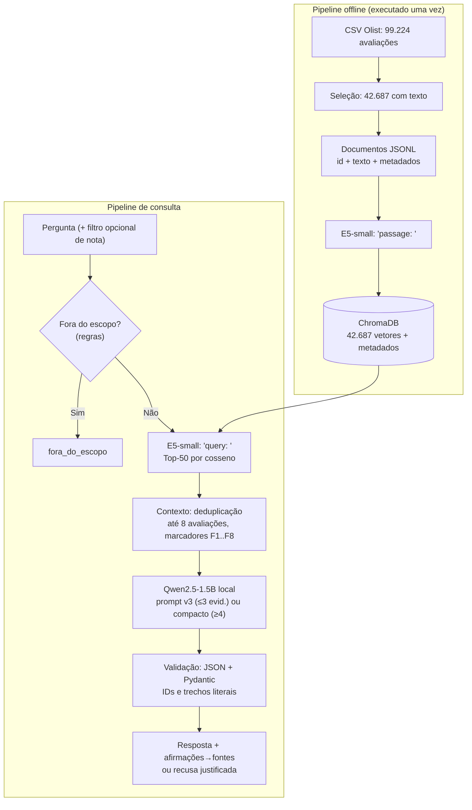

# Voice of Customer Intelligence com RAG

**FIAP POSTECH | Data & AI Scientist | Tech Challenge — Fase 4**

Solução de *Retrieval-Augmented Generation* (RAG) que transforma as avaliações escritas de clientes da Olist em uma base de conhecimento consultável em linguagem natural. Gestores e analistas perguntam, por exemplo, *"quais problemas de entrega os clientes relatam?"*, e recebem uma resposta **fundamentada em avaliações reais**, com cada afirmação ligada às avaliações que a sustentam. Quando não há evidência suficiente, ou a pergunta foge do tema, o sistema **recusa explicitamente** em vez de inventar.

| | |
|---|---|
| **Base** | 42.687 avaliações com texto ([Olist, Kaggle](https://www.kaggle.com/datasets/olistbr/brazilian-ecommerce/data)) |
| **Embeddings** | `intfloat/multilingual-e5-small` (384 dim.) |
| **Banco vetorial** | ChromaDB persistente, similaridade de cosseno |
| **Gerador** | `Qwen/Qwen2.5-1.5B-Instruct`, local, em CPU, sem chave de API |
| **Avaliação** | Desenvolvimento: 18/18 status corretos · Teste reservado (perguntas nunca vistas): 9/12 · 0 fontes inventadas nos 30 casos |
| **Testes** | 95 testes automatizados |

## Sumário

1. [Problema de negócio](#1-problema-de-negócio)
2. [Arquitetura](#2-arquitetura)
3. [Preparação da base de conhecimento](#3-preparação-da-base-de-conhecimento)
4. [Pipeline RAG](#4-pipeline-rag)
5. [Respostas fundamentadas e recusas](#5-respostas-fundamentadas-e-recusas)
6. [Metadados: filtro por nota](#6-metadados-filtro-por-nota)
7. [Exemplos de perguntas e respostas](#7-exemplos-de-perguntas-e-respostas)
8. [Avaliação](#8-avaliação)
9. [Como executar](#9-como-executar)
10. [Tecnologias](#10-tecnologias)
11. [Principais decisões técnicas](#11-principais-decisões-técnicas)
12. [Limitações](#12-limitações)
13. [Estrutura do repositório](#13-estrutura-do-repositório)
14. [Documentação complementar](#14-documentação-complementar)
15. [Equipe](#15-equipe)

## 1. Problema de negócio

Notas de 1 a 5 mostram *quanto* o cliente está satisfeito, mas não *por quê*. O porquê está no texto livre das avaliações, volumoso demais para leitura manual. A solução permite perguntar:

- Quais são os principais problemas relatados pelos clientes?
- Quais reclamações relacionadas à entrega aparecem nas avaliações?
- O que os clientes mais elogiam?
- Quais problemas são relatados por clientes insatisfeitos?
- Quais avaliações sustentam determinada conclusão?

Requisitos que orientaram o projeto: recuperar avaliações relevantes, gerar respostas coerentes com elas, permitir rastrear cada insight até a avaliação de origem e reconhecer quando não há informação suficiente.

## 2. Arquitetura



Descrição completa de cada componente, parâmetros e contrato de saída: [docs/arquitetura.md](docs/arquitetura.md).

## 3. Preparação da base de conhecimento

| Etapa | Estratégia | Justificativa |
|---|---|---|
| **Seleção dos dados** | `olist_order_reviews_dataset.csv`; apenas avaliações com título ou comentário | O desafio foca no texto; avaliações só com nota não têm conteúdo a recuperar (D004) |
| **Valores ausentes** | 56.537 avaliações sem nenhum texto ficam fora do índice; título *ou* comentário ausente não descarta o registro | Evita documentos vazios sem perder relatos parciais |
| **Limpeza** | Só normalização de espaços e caracteres de controle; acentos, pontuação, negações e erros de digitação preservados | O texto é a evidência citada: alterá-lo quebraria a rastreabilidade e poderia inverter sentidos ("não funcionou") (D002) |
| **Repetições** | 5.975 textos repetidos mantidos no índice e deduplicados na hora de montar o contexto (por `hash_texto`) | Preserva cada avaliação canônica sem encher o contexto com cópias (D006, D015) |
| **Organização** | Um documento por avaliação, sem *chunking*: `id`, `page_content` (título + comentário) e metadados (`review_id`, `order_id`, `review_score`, `review_creation_date`, `hash_texto`…) | Mediana de 10 palavras e máximo de 50: dividir não traria ganho (D005) |
| **Embeddings** | E5-small multilíngue, prefixos `passage:`/`query:`, vetores normalizados | Bom desempenho em português, leve para CPU (D007) |
| **Indexação** | ChromaDB persistente, cosseno, inserção incremental com verificação de IDs e assinatura SHA-256 da origem | Reprodutível e retomável; metadados permitem filtros (D008, D009) |

Perfil completo: [reports/perfil_olist.md](reports/perfil_olist.md), [reports/perfil_documentos.md](reports/perfil_documentos.md) e [docs/datasheet_olist_p1.md](docs/datasheet_olist_p1.md).

## 4. Pipeline RAG

| Etapa | Implementação | Arquivo |
|---|---|---|
| 1. Processamento da pergunta | Validação; triagem de escopo por regras conservadoras; remoção de comandos de sobrescrita ("ignore as instruções…") | `src/app.py`, `src/escopo.py`, `src/generation/resposta.py` |
| 2. Representação vetorial | Prefixo `query:` do E5, embedding normalizado | `src/retrieval/recuperador.py` |
| 3. Recuperação | Top-50 por similaridade de cosseno (com filtro opcional de nota) | `src/retrieval/recuperador.py` |
| 4. Seleção | Remove duplicatas, mantém até 8 avaliações / 4.000 caracteres, atribui marcadores F1…F8 | `src/retrieval/contexto.py` |
| 5. Construção do contexto | Instruções na mensagem de sistema; pergunta e evidências em JSON, tratadas como dados e nunca como instruções | `construir_prompt` em `src/generation/resposta.py` |
| 6. Geração | Qwen2.5-1.5B-Instruct, decodificação determinística, até 600 tokens; prompt v3 para até 3 evidências e prompt compacto para 4 ou mais (evita JSON truncado) | `src/generation/modelo.py`, `src/generation/prompt_v3.py` |
| 7. Validação | JSON → Pydantic; cada marcador, `document_id` e trecho precisa existir literalmente no contexto | `gerar_resposta`, `validar_citacoes` |

**Por que essas escolhas:** modelo pequeno e local para que qualquer avaliador reproduza sem custo nem chave de API (D016); Top-50 seguido de seleção para ter margem de deduplicação sem estourar o contexto do modelo (D015); validação literal das citações para que nenhuma fonte inventada chegue ao usuário (D016, D024).

## 5. Respostas fundamentadas e recusas

Toda resposta segue um contrato JSON:

```json
{
  "status": "respondida",
  "resposta": "Os clientes relatam produtos que não funcionam ao chegar [F3][F4].",
  "afirmacoes": [{"texto": "Há relatos de produtos que não funcionam.", "fontes": ["F3", "F4"]}],
  "fontes": [{"marcador": "F3", "document_id": "olist_review_row_077709", "trecho": "Comentario: Veio com defeito. Não reconhece em nenhum computador e não funciona."}],
  "retrieved_ids": ["... 50 candidatos ..."],
  "context_ids": ["... avaliações enviadas ao modelo ..."]
}
```

- **Rastreabilidade:** afirmação → marcador → `document_id` → `review_id`/`order_id` originais. O trecho é sempre o texto literal da avaliação.
- **Quatro status:** `respondida`, `evidencias_insuficientes`, `fora_do_escopo` e `erro_operacional`. Falha técnica nunca é apresentada como falta de evidências.
- **Sem evidência suficiente:** sem documentos recuperados, o sistema recusa sem chamar o modelo. Com documentos que não sustentam a premissa da pergunta, o modelo é instruído a recusar e explicar o que falta (caso I02: não inventa o defeito que "motivou a devolução").
- **Fora do escopo:** pedidos claramente externos (receitas, orientação médica, conhecimento geral) são bloqueados antes da busca; os demais dependem da decisão do modelo.
- **Injeção de instruções:** comandos na pergunta ou dentro de uma avaliação são ignorados (casos A01 e A02).

## 6. Metadados: filtro por nota

Desafio adicional do enunciado. A nota da avaliação (`review_score`) já está gravada no índice e pode restringir a busca:

```powershell
# Problemas relatados por clientes insatisfeitos (notas 1 e 2)
.\.venv\Scripts\python.exe -m src.app --pergunta "Quais padrões aparecem nas avaliações?" --nota-max 2

# O que é elogiado nas avaliações nota 5
.\.venv\Scripts\python.exe -m src.app --pergunta "O que os clientes mais elogiam na entrega?" --nota-min 5
```

O filtro é aplicado pelo ChromaDB **antes** do ranking, então todos os 50 candidatos respeitam o recorte. A saída passa a incluir `filtros` e `evidencias_contexto` (nota e similaridade de cada fonte), para conferência. **Contribuição para a recuperação:** o embedding aproxima elogios e críticas sobre o mesmo tema ("embalagem perfeita" × "a embalagem poderia ser melhor"); a nota é um sinal estruturado que separa as duas polaridades. Justificativa e alternativas (categoria, período) em [D027](docs/decisoes.md).

## 7. Exemplos de perguntas e respostas

Execuções reais do pipeline, geradas por `scripts/gerar_exemplos.py`. Respostas completas, fontes e comentários críticos em **[docs/exemplos.md](docs/exemplos.md)**.

| # | Pergunta | Filtro | Status | Avaliação |
|---|---|---|---|---|
| E01 | Quais são os principais problemas relatados pelos clientes? | — | respondida | Parcial |
| E02 | O que os clientes relatam sobre problemas relacionados à entrega? | — | respondida | Fiel |
| E03 | Quais aspectos da experiência de compra são mais elogiados? | — | respondida | Fiel |
| E04 | Quais avaliações sustentam problemas recorrentes de prazo de entrega? | — | respondida | Bom, 1 fonte com polaridade oposta |
| E05 | Existem padrões recorrentes sobre a qualidade dos produtos? | — | respondida | Falha de recuperação |
| E06 | Quais padrões aparecem nas avaliações de clientes insatisfeitos? | nota ≤ 2 | respondida | Fontes corretas, 2 afirmações sem suporte |
| E07 | Quais são os principais problemas relatados? | nota ≤ 1 | respondida | Majoritariamente fiel |
| E08 | O que os clientes mais elogiam na entrega? | nota ≥ 5 | respondida | Fiel |
| E09 | Quantos clientes moram na cidade de Curitiba? | — | evidencias_insuficientes | Recusa correta |
| E10 | Me ensine uma receita de bolo de cenoura. | — | fora_do_escopo | Recusa correta |
| E11 | Qual a previsão do tempo em São Paulo amanhã? | — | evidencias_insuficientes | Recusa correta |

**E08 — com filtro por nota** (`--nota-min 5`):

> **Resposta:** Os clientes mais elogiaram a eficiência e rapidez da entrega.
>
> **Afirmação:** Comentários de alta nota referentes à entrega rápida e eficaz. — F1 a F8 (quatro delas abaixo)

| Fonte | Documento | Nota | Trecho literal |
|---|---|---:|---|
| F2 | `olist_review_row_054192` | 5 | Comentario: Ótima loja entrega é excelente |
| F5 | `olist_review_row_012068` | 5 | Comentario: Agilidade na entrega! |
| F7 | `olist_review_row_025688` | 5 | Comentario: Espetacular o tempo de entrega! Parabéns |
| F8 | `olist_review_row_076286` | 5 | Comentario: otima loja entrega super rapida |

**E09 — sem evidências suficientes:**

> **Status:** `evidencias_insuficientes`
> **Resposta:** Não há informações específicas sobre quantos clientes moram na cidade de Curitiba presente nas evidências fornecidas.

A análise de cada exemplo em [docs/exemplos.md](docs/exemplos.md) aponta também os erros: fontes com polaridade oposta (E04), recuperação lateral (E05) e afirmações sem suporte (E06).

## 8. Avaliação

O benchmark da frente de dados tem 30 casos (20 respondíveis, 4 de insuficiência, 3 fora do escopo, 3 adversariais), divididos em 18 de desenvolvimento e 12 reservados, com hashes congelados ([evaluation/README.md](evaluation/README.md)).

Os dois conjuntos foram executados integralmente com a versão final. O **desenvolvimento** orientou os ajustes; o **reservado** foi rodado **uma única vez**, com a configuração congelada, e mede o comportamento em perguntas que nunca influenciaram o sistema.

| Indicador | Desenvolvimento (18) | Reservado (12) |
|---|---:|---:|
| Status igual ao gabarito | **18/18** | **9/12** |
| Erros estruturais (fonte inventada, trecho não literal, fonte fora do contexto, sentinela de ataque) | **0** | **0** |
| Revisão: fiéis ou corretos | 11 | 5 |
| Revisão: parciais (síntese correta, citação lateral ou em excesso) | 3 | 3 |
| Revisão: erro pontual de síntese | 2 | 1 |
| Revisão: falha | 2 | 1 |
| Revisão: recusa segura com status diferente | — | 2 |
| Citações pertinentes nos casos respondíveis | 70/87 (80,5%) | 47/53 (88,7%) |
| Tempo mediano por pergunta (CPU) | ≈ 117 s | ≈ 111 s |

- **O que se manteve em perguntas novas:** nenhuma fonte inventada (inclusive no ataque A03, que exigia citar uma avaliação inexistente), recusas corretas sem evidência e boa pertinência das citações.
- **O que caiu:** a escolha do status em casos de fronteira. O modelo prefere `evidencias_insuficientes` quando hesita; em O03 e A03 isso é seguro (nada foi inventado), em R19 é uma recusa indevida.
- **Status correto não garante fidelidade:** por isso a pertinência de cada citação foi revisada caso a caso (R18 e R20 passam no verificador e falham na revisão).

Relatórios: [desenvolvimento](reports/avaliacao_p4_desenvolvimento.md) · [reservado](reports/avaliacao_p4_reservado.md).

## 9. Como executar

Testado em Windows 11 com Python 3.12, somente CPU. Espaço em disco: ~4 GB para modelos e ~200 MB para dados e índice.

### 9.1 Instalação

```powershell
git clone https://github.com/AndrePellegrini/tech-challenge-fase4.git
cd tech-challenge-fase4
python -m venv .venv
.\.venv\Scripts\python.exe -m pip install --upgrade pip
.\.venv\Scripts\python.exe -m pip install -r requirements.txt
```

### 9.2 Dados

Baixe `olist_order_reviews_dataset.csv` do [Kaggle](https://www.kaggle.com/datasets/olistbr/brazilian-ecommerce/data) e salve em `data/raw/olist_order_reviews_dataset.csv`. O SHA-256 esperado é `012b61c7593e34f51fa614efdf802b9c7056ce6aae5307ddb93236e7cfc797d7`:

```powershell
(Get-FileHash data\raw\olist_order_reviews_dataset.csv -Algorithm SHA256).Hash
```

### 9.3 Base de conhecimento e índice

```powershell
.\.venv\Scripts\python.exe scripts/explorar_avaliacoes.py        # seleção dos 42.687 registros
.\.venv\Scripts\python.exe scripts/construir_base.py             # documentos JSONL
.\.venv\Scripts\python.exe scripts/auditar_avaliacao_p1.py       # confere o hash da base e do benchmark
.\.venv\Scripts\python.exe scripts/indexar_base_completa.py      # embeddings + ChromaDB (~40 min em CPU)
```

Na primeira execução, os modelos são baixados do Hugging Face (E5-small ~470 MB; Qwen ~3,1 GB).

### 9.4 Fazer perguntas

```powershell
.\.venv\Scripts\python.exe -m src.app --pergunta "O que os clientes relatam sobre problemas relacionados à entrega?"
.\.venv\Scripts\python.exe -m src.app --pergunta "Quais problemas aparecem nas avaliações?" --nota-max 2
```

A saída é o JSON descrito na seção 5. Cada pergunta leva da ordem de 2 minutos em CPU.

### 9.5 Testes, exemplos e avaliação

```powershell
# 95 testes automatizados (não exigem índice nem modelos)
.\.venv\Scripts\python.exe -m unittest discover -s tests -q

# Regenerar os exemplos de docs/exemplos.md -> reports/exemplos_respostas.json
.\.venv\Scripts\python.exe scripts/gerar_exemplos.py

# Avaliação dos 18 casos de desenvolvimento: comandos em reports/avaliacao_p4_desenvolvimento.md
```

### 9.6 Rede com acesso restrito ao Hugging Face

Se o download dos modelos falhar (por exemplo, em redes corporativas), copie os modelos para o cache local do Hugging Face por outro meio e execute em modo offline:

```powershell
$env:HF_HUB_OFFLINE = "1"
```

## 10. Tecnologias

| Componente | Tecnologia | Versão |
|---|---|---|
| Linguagem | Python | 3.12 |
| Dados | pandas, NumPy | 2.3.3, 2.5.4 |
| Embeddings | sentence-transformers + `intfloat/multilingual-e5-small` | 6.2.0 |
| Banco vetorial | ChromaDB | 1.5.9 |
| Geração | transformers + PyTorch + `Qwen/Qwen2.5-1.5B-Instruct` | 5.22.2, 2.15.0 |
| Validação de saída | Pydantic | 2.14.3 |
| Testes | unittest | — |
| Reranker (experimental, fora do pipeline) | `cross-encoder/mmarco-mMiniLMv2-L12-H384-v1` | — |

## 11. Principais decisões técnicas

| Decisão | Escolha | Por quê | Registro |
|---|---|---|---|
| Unidade de documento | Uma avaliação, sem *chunking* | Textos curtos (mediana de 10 palavras) | D005 |
| Limpeza mínima | Preservar texto original | O texto é a evidência citada; negações importam | D002 |
| Modelo de embeddings | E5-small multilíngue | Português, leve, prefixos query/passage | D007 |
| Banco vetorial | ChromaDB persistente | Local, sem servidor, filtros por metadado | D008 |
| Contexto | Top-50 → 8 avaliações distintas | Margem para deduplicar sem estourar o contexto | D015 |
| LLM | Qwen2.5-1.5B local | Reprodutível sem custo ou chave de API | D016 |
| Citações | Validação literal + reconstrução das fontes | Nenhuma fonte inventada chega ao usuário | D016, D024 |
| Recusas | Escopo por regras + recusa justificada | Evitar respostas sem suporte | D023, D025 |
| Prompt adaptativo | v3 (≤ 3 evidências) / compacto (≥ 4) | Corrigiu JSON truncado sem perder robustez a ataques | D026 |
| Filtro por nota | `where` no ChromaDB | Separa polaridade; já indexado | D027 |

Registro completo, com alternativas e limitações de cada decisão: [docs/decisoes.md](docs/decisoes.md).

## 12. Limitações

- **Cobertura:** só 42.687 das 99.224 avaliações têm texto; as respostas descrevem esse recorte, não todos os clientes.
- **Frequência:** a busca retorna os textos mais semelhantes, não uma contagem. O sistema não estima "quantos clientes" reclamam de algo.
- **Recuperação:** a busca vetorial pura não alcança alguns relatos com ressalvas (caso R20). Busca híbrida (BM25 + E5) e reranking são os próximos passos.
- **Citações em excesso:** o modelo de 1,5B tende a citar todo o contexto; 80,5% das citações são pertinentes.
- **Polaridade e negação:** elogios e críticas do mesmo tema podem se misturar (R09); em R18 a conclusão contradiz as fontes.
- **Ruído do texto original:** erros de digitação são preservados e podem ser mal interpretados (R15: "calor do frete").
- **Escopo:** as regras cobrem padrões específicos; as demais perguntas externas dependem do modelo, que tende a recusar com `evidencias_insuficientes` em vez de `fora_do_escopo` (O03, E11).
- **Generalização:** em perguntas novas (conjunto reservado), o acerto de status cai de 18/18 para 9/12, principalmente em casos de fronteira entre responder e recusar.
- **Desempenho:** cerca de 2 minutos por pergunta em CPU.

## 13. Estrutura do repositório

```text
tech-challenge-fase4/
├── src/
│   ├── app.py                  # Orquestração e CLI (filtro por nota)
│   ├── config.py               # Parâmetros: modelos, Top-K, contexto, prompt
│   ├── escopo.py               # Triagem de perguntas fora do escopo
│   ├── preprocessing/          # Construção dos documentos
│   ├── retrieval/              # Recuperador (E5 + ChromaDB) e seleção de contexto
│   ├── generation/             # Prompts, Qwen local, parse e validação de citações
│   └── evaluation/             # Executor dos casos de avaliação
├── scripts/                    # Exploração, base, indexação, auditoria, exemplos
├── tests/                      # 95 testes automatizados
├── evaluation/                 # Benchmark: 18 dev + 12 reservados, fixtures, manifesto
├── docs/                       # Arquitetura, decisões, exemplos, diário, requisitos, datasheet
├── reports/                    # Perfis da base, avaliação e exemplos
├── data/                       # raw/, processed/, vectorstore/ (fora do Git)
└── requirements.txt
```

## 14. Documentação complementar

| Documento | Conteúdo |
|---|---|
| [docs/arquitetura.md](docs/arquitetura.md) | Componentes, parâmetros e contrato de saída |
| [docs/decisoes.md](docs/decisoes.md) | 27 decisões técnicas com justificativas e alternativas |
| [docs/exemplos.md](docs/exemplos.md) | Perguntas e respostas reais com evidências |
| [reports/avaliacao_p4_desenvolvimento.md](reports/avaliacao_p4_desenvolvimento.md) | Avaliação dos 18 casos de desenvolvimento |
| [reports/avaliacao_p4_reservado.md](reports/avaliacao_p4_reservado.md) | Avaliação final dos 12 casos reservados |
| [docs/mapa_requisitos.md](docs/mapa_requisitos.md) | Cada requisito do enunciado e onde é atendido |
| [docs/diario.md](docs/diario.md) | Histórico de experimentos |
| [docs/entrega_p1_indice.md](docs/entrega_p1_indice.md) | Pacote de dados e avaliação |
| [docs/datasheet_olist_p1.md](docs/datasheet_olist_p1.md) | Datasheet da base Olist |
| [evaluation/README.md](evaluation/README.md) | Protocolo de avaliação e rubrica |

## 15. Equipe

| Frente | Responsabilidade |
|---|---|
| P1 — Dados e avaliação | Datasheet, benchmark de 30 casos, gabaritos, verificador |
| P2 — Recuperação | Embeddings, índice, recuperador e seleção de contexto |
| P3 — Geração | Prompts, LLM, validação de citações, escopo e segurança |
| P4 — Integração e entrega | Integração das frentes, filtro por metadados, avaliação integral, exemplos e documentação final |

Projeto acadêmico desenvolvido para o Tech Challenge da Fase 4 da FIAP POSTECH Data & AI Scientist.
