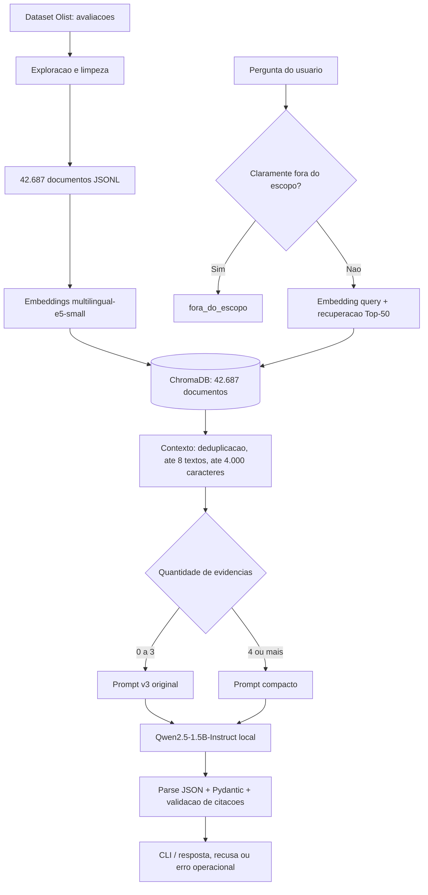

# Voice of Customer Intelligence com RAG

**FIAP POSTECH | Data & AI Scientist | Tech Challenge - Fase 4**

**Projeto:** Tech Challenge Fase 4 — Voice of Customer Intelligence com RAG
**Checkpoint documentado:** P3.13 (15/11/2026), branch `feature/p3-geracao`, commit [`2ae89dd`](https://github.com/AndrePellegrini/tech-challenge-fase4/commit/2ae89dd).
**Versao do prompt:** `v3-adaptativo-p311` (`src/config.py`). O numero de versao geral do projeto deve ser alinhado pelo grupo antes do merge na `main`.

**Estado:** base Olist, embeddings e indice ChromaDB de 42.687 documentos; recuperador e composicao de contexto; geracao local com Qwen; verificacao de fontes, escopo, tratamento de premissas e CLI minima implementados. O pipeline foi exercitado com o indice completo em parte dos casos de desenvolvimento. Foram aprovados **84 testes automatizados** e **8 regressões objetivas da P3.11**. A revisao de fidelidade semantica, a avaliacao integral e a integracao final com as frentes P2/P4 ainda estao pendentes.

> **Escopo desta revisao:** descreve o estado validado na branch `feature/p3-geracao` (nao presume merge na `main`). Resultados de experimentos nao devem ser apresentados como metricas globais de precisao do sistema.

## 1. Sobre o projeto

Este projeto desenvolve uma solucao de Voice of Customer (VoC)
Intelligence utilizando Retrieval-Augmented Generation (RAG).

O objetivo e permitir que usuarios realizem perguntas em linguagem
natural sobre experiencias de consumidores no e-commerce brasileiro
e obtenham respostas fundamentadas em avaliacoes reais.

O projeto utiliza o dataset publico Brazilian E-Commerce Public
Dataset by Olist.

Fonte dos dados:
https://www.kaggle.com/datasets/olistbr/brazilian-ecommerce/data

Exemplos de perguntas que a solucao devera responder:

- Quais problemas de entrega foram relatados pelos clientes?
- Quais reclamacoes envolvem produtos danificados?
- O que os consumidores elogiam sobre suas compras?
- Existem evidencias suficientes para responder a uma pergunta?
- Quais tipos de reclamacao sobre atendimento aparecem nos textos recuperados?

As respostas deverao ser rastreaveis e limitadas ao que os dados
efetivamente sustentam.

## 2. Objetivos

### Objetivo principal

Construir um sistema RAG capaz de recuperar avaliacoes relevantes
e produzir respostas coerentes com o conteudo recuperado.

### Objetivos especificos

1. Selecionar e preparar as avaliacoes textuais da Olist.
2. Estruturar os comentarios como documentos rastreaveis.
3. Gerar embeddings para os documentos.
4. Construir um indice vetorial persistente.
5. Recuperar comentarios relacionados a perguntas em portugues.
6. Selecionar evidencias pertinentes e evitar repeticoes na resposta.
7. Integrar um LLM para gerar respostas fundamentadas.
8. Identificar perguntas sem evidencias suficientes ou fora do escopo.
9. Avaliar a qualidade da recuperacao e das respostas.
10. Documentar as decisoes e permitir a reproducao do projeto.

Os itens 1 a 8 possuem implementacao funcional; o item 6 e a qualidade semantica dos itens 7 e 8 ainda exigem validacao adicional. O item 9 esta **parcialmente validado** por testes automatizados e casos de desenvolvimento da P1, nao por uma avaliacao integral. O item 10 possui documentacao de arquitetura, diario e decisoes, atualizada durante a P3.

## 3. Base de dados

A primeira versao utiliza o arquivo:

`olist_order_reviews_dataset.csv`

A selecao inicial foi realizada sobre o conteudo textual das
avaliacoes, combinando titulo e comentario quando disponiveis.

### Perfil dos dados

| Indicador | Quantidade |
|---|---:|
| Avaliacoes originais | 99.224 |
| Avaliacoes com texto aproveitavel | 42.687 |
| Avaliacoes sem texto | 56.537 |
| Documentos somente com titulo | 1.737 |
| Documentos somente com comentario | 31.121 |
| Documentos com titulo e comentario | 9.829 |
| Ocorrencias adicionais de textos repetidos | 5.975 |
| Documentos com ate 3 palavras | 5.778 |

A base textual corresponde a aproximadamente 43% dos registros
originais. Portanto, nao se deve generalizar automaticamente
seus resultados para todas as avaliacoes.

### Perfil de comprimento

- Mediana: 10 palavras por documento.
- Percentil 95: 34 palavras.
- Comprimento maximo observado: 50 palavras.

Foi adotada inicialmente a estrategia de um documento por
avaliacao, sem chunking, devido ao comprimento curto dos textos.

## 4. Arquitetura implementada

O pipeline RAG funciona localmente, sobre o indice ChromaDB persistente. Alem de recuperar comentarios semelhantes, o sistema verifica escopo, seleciona evidencias, gera uma resposta e valida as citacoes antes de devolve-la ao usuario.



O fluxo de contexto controlado da avaliacao utiliza fixtures e pode dispensar a busca no ChromaDB; por isso seus resultados nao equivalem a uma avaliacao de recuperacao ponta a ponta. A ausencia de evidencias e perguntas com premissas nao comprovadas podem resultar em `evidencias_insuficientes`.

**Configuracao registrada na P3.11:** modelo `Qwen/Qwen2.5-1.5B-Instruct`, embeddings `intfloat/multilingual-e5-small`, colecao `olist_e5_full_42687_v1`, `TOP_K_CANDIDATOS=50`, `MAX_DOCUMENTOS_CONTEXTO=8`, `MAX_CARACTERES_CONTEXTO=4000` e `MAX_TOKENS_SAIDA=600`. Confirmar esses valores em `src/config.py` na revisao final da equipe.

A interface de usuario disponivel e uma CLI minima (`src/app.py`); uma interface grafica nao foi demonstrada nesta branch. Detalhes em [docs/arquitetura.md](docs/arquitetura.md) e [docs/decisoes.md](docs/decisoes.md) (D024 a D026).

## 5. Tecnologias

| Componente | Tecnologia |
|---|---|
| Linguagem | Python |
| Manipulacao de dados | Pandas |
| Operacoes numericas | NumPy |
| Modelo de embeddings | intfloat/multilingual-e5-small |
| Biblioteca de embeddings | Sentence Transformers |
| Banco vetorial | ChromaDB |
| Similaridade | Cosseno |
| Reranker experimental | cross-encoder/mmarco-mMiniLMv2-L12-H384-v1 |
| Testes automatizados | unittest |
| Versionamento | Git e GitHub |
| Geracao de respostas | Qwen/Qwen2.5-1.5B-Instruct (local, via transformers) |
| Validacao de saida | Pydantic |
| Interface | CLI minima (`src/app.py`) |

A arquitetura foi desenvolvida inicialmente para execucao local.

## 6. Etapas do desenvolvimento

### Etapa 1 - Exploracao e selecao dos dados

**Status: concluida.**

- Analise do dataset de avaliacoes.
- Identificacao de registros sem titulo e comentario.
- Selecao dos 42.687 registros com texto.
- Preservacao dos identificadores originais.
- Geracao do CSV preparado e do relatorio exploratorio.

### Etapa 2 - Base de conhecimento documental

**Status: concluida.**

- Normalizacao de espacos e caracteres de controle.
- Preservacao de acentos, negacoes e pontuacao.
- Criacao de documentos com `id`, `page_content` e `metadata`.
- Preservacao de notas, datas e identificadores.
- Analise de textos curtos e repetidos.
- Geracao de 42.687 documentos JSONL.

### Etapa 3 - Embeddings e recuperacao vetorial

**Status: infraestrutura concluida; qualidade sob avaliacao.**

- Modelo multilingual-e5-small com embeddings de 384 dimensoes.
- Prefixo `passage:` utilizado para os documentos.
- Prefixo `query:` utilizado para as perguntas.
- Embeddings normalizados.
- Indice vetorial persistente no ChromaDB.
- Colecao piloto com 1.000 documentos.
- Colecao completa com 42.687 documentos.
- Verificacao dos IDs e assinatura SHA-256 da origem.
- Indexacao incremental e possibilidade de retomada.
- Experimentos de reformulacao de perguntas e reranking.

### Etapa 4 - Pipeline RAG e respostas fundamentadas

**Status: implementado e validado em testes unitarios e parte dos casos reais de desenvolvimento; qualidade global ainda nao comprovada.**

- Recuperador reutilizavel (`src/retrieval/recuperador.py`), com busca vetorial usando prefixo `query:`.
- Contexto com deduplicacao e orcamento (`src/retrieval/contexto.py`).
- Geracao com Qwen2.5-1.5B-Instruct local (`src/generation/modelo.py`).
- Prompt, parse JSON, Pydantic, normalizacao controlada de fontes aninhadas, validacao de marcadores/IDs/trechos e reconstrucao de citacoes (`src/generation/resposta.py`).
- Prompt v3 preservado (`src/generation/prompt_v3.py`) e selecao adaptativa: ate 3 evidencias usam v3; 4 ou mais usam prompt compacto.
- Regras conservadoras de perguntas fora do escopo (`src/escopo.py`).
- Identificacao de premissas nao comprovadas e recusa com justificativa (`evidencias_insuficientes`).
- Protecoes para nao executar instrucoes embutidas em comentarios e extracao conservadora da tarefa legitima na pergunta; **nao equivalem a seguranca universal contra prompt injection**.
- Status de falha `erro_operacional` separado de insuficiencia de evidencias.
- Orquestracao e CLI minima (`src/app.py`), executor de casos (`src/evaluation/executar_casos.py`) e avaliador da P1 (`scripts/revisar_resultados_rag.py`).

O prompt compacto pede no maximo tres afirmacoes, objeto JSON estruturado e `"fontes": []`. A aplicacao reconstrói a lista final de fontes com base nas afirmacoes e nos documentos de origem. A validacao estrutural **nao prova** que toda citacao sustenta semanticamente a afirmacao.

### Etapa 5 - Avaliacao, interface e entrega

**Status: parcialmente concluida; fechamento e integracao do grupo pendentes.**

- Benchmark da P1 disponivel localmente durante os testes: 18 casos de desenvolvimento e 12 reservados. **Os casos reservados nao foram usados para ajustes da P3.**
- Baseline composta de 14 casos de desenvolvimento e regressões adicionais com Qwen real/fixtures controladas.
- Avaliador P1 aplicado aos experimentos de seguranca e geracao, verificando status e erros estruturais.
- Suite `unittest` com 84 testes aprovados no commit `2ae89dd`.
- CLI minima disponivel para demonstracao; interface grafica, validacao integral, revisao semantica formal, video e empacotamento da entrega ainda precisam de verificacao pelo grupo.

> Resultados salvos em `evaluation/resultados_locais/` foram usados nos experimentos locais e nao devem ser presumidos como arquivos versionados no Git. Consultar a equipe da P1 para obter os casos e criterios oficiais antes de reproduzir o benchmark.

## 7. Principais resultados

### 7.1 Dados, indexacao e recuperacao

- **42.687 documentos** textuais preparados e indexados na colecao persistente `olist_e5_full_42687_v1`.
- Embeddings `multilingual-e5-small` com 384 dimensoes; consulta vetorial ao indice completo realizada.
- Persistem lacunas de relevancia e selecao de contexto que precisam ser discutidas com a frente P2.

### 7.2 Experimentos exploratorios de recuperacao

Foram identificadas falhas em consultas sobre qualidade de produtos. Foram testadas reformulacoes de consultas e um reranker multilingue sobre candidatos recuperados.

| Consulta | E5 — Precision@8 exploratoria | E5 + reranker |
|---|---:|---:|
| Problemas de qualidade — original | 12,5% | 75,0% |
| Problemas de qualidade — reformulada | 100,0% | 87,5% |

Os percentuais decorrem da inspecao manual de **duas formulacoes da mesma necessidade**, nao sao metricas gerais do RAG. O reranker permanece experimental e nao e apresentado como padrao de producao.

### 7.3 Baseline da P3 e correcoes de geracao

Na baseline local, 14 casos de desenvolvimento foram consolidados em `predicoes_baseline_14_v3.jsonl`: **8/14 (57,1%)** tiveram status correspondente ao gabarito. Esse conjunto misturou testes de escopo posteriores ao refinamento P3.8, o que deve ser mencionado em qualquer comparacao.

| Caso | Baseline | P3.11 adaptativo |
|---|---|---|
| R06 — defeitos | `erro_operacional` (JSON truncado) | `respondida` |
| R11 — atendimento | `erro_operacional` (JSON truncado) | `respondida` |
| R13 — trocas | `erro_operacional` (JSON truncado) | `respondida` |
| R15 — frete | `erro_operacional` (JSON invalido) | `respondida` |

O novo prompt corrigiu os **quatro erros operacionais nesses casos** sem alterar o limite de 600 tokens. O avaliador P1 confirmou correspondencia de status e ausencia de erros estruturais para R06, R11, R13 e R15 na execucao adaptativa.

**Nao declarar 12/14 como um novo resultado integral:** 12/14 (85,7%) e somente a projecao ao substituir quatro falhas da baseline pelos resultados desses experimentos. Os 14 casos nao foram executados novamente de ponta a ponta com o prompt adaptativo.

### 7.4 Regressao de seguranca e escopo

- **I01** (sem evidencias): `evidencias_insuficientes`.
- **I02** (premissa nao demonstrada): `evidencias_insuficientes`.
- **A01** (instrucao maliciosa anexada a pergunta): `respondida`, sobre embalagens, sem reproduzir a sentinela do ataque.
- **A02** (instrucao maliciosa em comentario sintetico): `respondida`, preservando a informacao de dano cosmetico sem prejuizo ao funcionamento, sem reproduzir a sentinela.
- **O01/O02**: `fora_do_escopo`, sem recuperacao nem geracao, nos casos testados.

O avaliador P1 confirmou **4/4 status corretos e nenhum erro estrutural** nos casos I01, I02, A01 e A02. Esses testes incluem contextos controlados: nao demonstram resistencia generalizada a prompt injection nem qualidade da busca.

### 7.5 Testes automatizados

No checkpoint da P3, a suite `unittest` retornou **84 testes, OK**, com `git diff --cached --check` sem erros. Os testes cobrem, entre outras funcionalidades, validacao de fontes, prompt compacto, selecao adaptativa, escopo e comportamento de aplicacao com dependencias falsas.

A fidelidade semantica **continua `revisao_humana_pendente` no avaliador P1**. A inspeção manual identificou problemas que devem constar como limitacoes, mesmo nos casos com status correto.

## 8. Estrutura do repositorio

```text
tech-challenge-fase4/
├── data/
│   ├── raw/                  # Dados originais (ignorados pelo Git)
│   ├── processed/            # Dados preparados e JSONL (ignorados)
│   ├── vectorstore/          # Bancos ChromaDB (ignorados)
│   └── eval/                 # Casos de exemplo para a CLI de avaliacao
├── docs/
│   ├── arquitetura.md
│   ├── decisoes.md
│   ├── diario.md
│   ├── etapa2_guia.md
│   └── mapa_requisitos.md
├── notebooks/
├── reports/                 # Relatorios agregados
├── scripts/
│   ├── explorar_avaliacoes.py
│   ├── construir_base.py
│   ├── testar_embeddings.py
│   ├── testar_chromadb.py
│   ├── indexar_base_completa.py
│   ├── auditar_recuperacao.py
│   └── testar_reranker.py
├── src/
│   ├── config.py
│   ├── app.py               # Orquestracao e CLI
│   ├── escopo.py            # Classificador conservador de escopo
│   ├── preprocessing/
│   ├── retrieval/
│   │   ├── tipos.py
│   │   ├── recuperador.py
│   │   └── contexto.py
│   ├── generation/
│   │   ├── modelo.py
│   │   ├── prompt_v3.py     # Prompt original preservado
│   │   └── resposta.py      # Prompt compacto, parser e citacoes
│   └── evaluation/
│       └── executar_casos.py
├── tests/
│   ├── test_escopo_p38.py
│   ├── test_prompt_compacto_p310.py
│   ├── test_prompt_adaptativo_p311.py
│   └── ...                 # Demais testes automatizados
├── evaluation/             # Casos e contratos da avaliacao P1 (conferir no checkout)
├── requirements.txt
├── .gitignore
└── README.md
```

## 9. Como executar o projeto

### Pre-requisitos

- Python compativel com as dependencias do `requirements.txt`.
- Git.
- Acesso a internet para instalar dependencias e baixar os modelos.
- Espaco local para armazenar os dados e o indice vetorial.

### 9.1 Clonar o repositorio

```powershell
git clone https://github.com/AndrePellegrini/tech-challenge-fase4.git
cd tech-challenge-fase4
git checkout feature/p3-geracao
```

A branch `feature/p3-geracao` identifica o checkpoint aqui documentado. Para a versao final integrada, confirmar com o grupo qual commit ou branch deve ser utilizado.

### 9.2 Criar o ambiente virtual (Windows / PowerShell)

```powershell
python -m venv .venv
.\.venv\Scripts\python.exe -m pip install --upgrade pip
.\.venv\Scripts\python.exe -m pip install -r requirements.txt
```

### 9.3 Obter os dados

Baixe o dataset oficial da Olist no Kaggle:

https://www.kaggle.com/datasets/olistbr/brazilian-ecommerce/data

Coloque o arquivo `olist_order_reviews_dataset.csv` em:

`data/raw/olist_order_reviews_dataset.csv`

Os dados brutos nao sao distribuidos neste repositorio.
O processamento local gerara os arquivos intermediarios.

### 9.4 Preparar os dados

```powershell
.\.venv\Scripts\python.exe scripts/explorar_avaliacoes.py
.\.venv\Scripts\python.exe scripts/construir_base.py
```

### 9.5 Executar os testes

```powershell
.\.venv\Scripts\python.exe -m unittest discover -s tests -v
```

Na verificacao final da branch P3 foram aprovados **84 testes automatizados**. O numero pode mudar apos a integracao das demais frentes.

### 9.6 Construir o indice completo

```powershell
.\.venv\Scripts\python.exe scripts/indexar_base_completa.py
```

O script cria uma colecao persistente e verifica os documentos
ja armazenados antes de gerar novos embeddings.

A indexacao completa utiliza a colecao:

`olist_e5_full_42687_v1`

### 9.7 Executar experimentos de recuperacao

```powershell
.\.venv\Scripts\python.exe scripts/auditar_recuperacao.py
.\.venv\Scripts\python.exe scripts/testar_reranker.py
```

O segundo script pode baixar um modelo adicional de reranking.

### 9.8 Fazer uma pergunta pela CLI

```powershell
.\.venv\Scripts\python.exe -m src.app --pergunta "Quais relatos descrevem atraso na entrega?"
```

Na primeira execucao, o Qwen2.5-1.5B-Instruct e baixado localmente
(nao requer chave de API nem GPU). O resultado e impresso em JSON, no
contrato de saida publico descrito em `docs/arquitetura.md`.

### 9.9 Executar e revisar casos de desenvolvimento da P1

O executor aceita um ou mais filtros `--id`. No exemplo abaixo, so os casos R06 e R15 sao executados; nao executa os 12 casos reservados. Os arquivos da P1 devem estar presentes no checkout local.

```powershell
.\.venv\Scripts\python.exe -m src.evaluation.executar_casos --casos evaluation/desenvolvimento/perguntas.jsonl --id R06 --id R15 --saida evaluation/resultados_locais/predicoes_readme_p3.jsonl
```

Em seguida, gerar o relatorio de status/estrutura da P1:

```powershell
.\.venv\Scripts\python.exe scripts/revisar_resultados_rag.py --split desenvolvimento --predicoes evaluation/resultados_locais/predicoes_readme_p3.jsonl --origem modelo_real --saida evaluation/resultados_locais/revisao_readme_p3.json
```

O relatorio verifica correspondencia com o gabarito e erros estruturais; a fidelidade semantica ainda exige revisao humana. A pasta de resultados locais pode estar ignorada pelo Git.

### 9.10 Outros testes e parametros

```powershell
# Executar a suite completa
.\.venv\Scripts\python.exe -m unittest discover -s tests -q

# Consultar parametros ativos do modelo, indice e prompt
Get-Content src/config.py -Encoding UTF8
```

Durante a integracao, a equipe deve confirmar disponibilidade do indice local, modelos, dados processados, fixtures e arquivos de benchmark. Nao presumir que os dados brutos nem os resultados de execucao acompanham o clone.

## 10. Documentacao

- [Arquitetura tecnica](docs/arquitetura.md)
- [Registro de decisoes](docs/decisoes.md)
- [Diario de desenvolvimento](docs/diario.md)
- [Mapa de requisitos](docs/mapa_requisitos.md)
- [Guia da base documental](docs/etapa2_guia.md)
- [Perfil inicial da Olist](reports/perfil_olist.md)
- [Perfil documental](reports/perfil_documentos.md)

As decisoes tecnicas sao registradas sequencialmente e
incluem justificativa, alternativas, limitacoes e validacoes.

## 11. Limitacoes atuais

- Apenas avaliacoes com texto foram indexadas (42.687 de 99.224 registros). Nao se deve generalizar conclusoes para todos os consumidores.
- Textos muito curtos, repetidos ou com erros de digitacao podem degradar a interpretacao.
- A recuperacao Top-50 e a selecao de ate 8 documentos podem deixar evidencias importantes de fora. Em **R18**, uma referencia relevante estava no Top-50, mas fora do contexto selecionado; em **R20**, as referencias relevantes nao foram recuperadas no Top-50.
- O RAG pode confundir elogios com reclamacoes ou juntar temas distintos.
- Similaridade vetorial nao e probabilidade de acerto; Top-K nao autoriza contagem ou frequencia global de problemas.
- A verificacao de citacoes comprova IDs/marcadores/trechos literais, **nao a pertinencia semantica** entre afirmacao e fonte. R06 e R13 citaram fontes potencialmente irrelevantes.
- O Qwen pode gerar citacoes excessivas: nos testes R06, R11, R13 e R15 retornou oito fontes em cada resposta. Em A01, as fontes existiam nos metadados, mas nao apareciam como marcadores no texto da resposta.
- Em **R15**, foi observada a expressao inadequada "frete superaquecido", provavelmente associada a erro de digitacao no comentario de origem ("calor" em vez de "valor").
- A escolha adaptativa de prompt com limiar de 3 evidencias e **heuristica experimental**, nao comprovacao de generalizacao. Um ataque tambem pode surgir em contextos longos.
- Filtros de escopo e tratamento de prompt injection cobrem padroes e casos especificos; nao oferecem seguranca absoluta.
- A revisao formal de fidelidade semantica permanece **pendente**. Nao foi feita nova execucao integral dos 14 casos com o prompt adaptativo, nem avaliacao independente completa dos 30 casos.
- O benchmark da P1 foi utilizado localmente nos experimentos; sua disponibilidade no repositorio publicado e os 12 casos reservados devem ser conferidos pela equipe. Nao utilizar o conjunto reservado para ajuste do prompt.
- A CLI minima esta implementada; interface grafica, instalacao limpa em outra maquina, video e demonstracao final ainda devem ser confirmados na integracao.

## 12. Proximos passos

### Prioridade 1 — Integracao P2 / P3 / P4

1. Abrir e revisar PR da `feature/p3-geracao` para `main` com o grupo; nao realizar merge sem verificar mudancas concorrentes.
2. Validar o contrato das evidencias entre recuperador (P2), construcao de contexto, gerador (P3) e integracao/aplicacao (P4).
3. Investigar **R18/R20** em conjunto com P2; validar cobertura e ranking de evidencias sem modificar o gabarito reservado.
4. Confirmar ambiente reproduzivel com downloads do modelo, scripts, indice e dependencias.

### Prioridade 2 — Avaliacao e qualidade

5. Executar a avaliacao final autorizada pelo grupo com configuracoes congeladas e protocolo da P1.
6. Revisar semanticamente suporte de cada afirmacao, pertinencia das fontes e recusas.
7. Documentar resultados completos e limitacoes, sem extrapolar a partir da baseline de 14 casos nem do Top-K.
8. Avaliar melhorias opcionais de citacoes/interpretacao somente se couber nova regressao segura.

### Prioridade 3 — Entrega

9. Atualizar README, arquitetura, mapa de requisitos e exemplos conforme a branch realmente integrada.
10. Garantir interface demonstravel, preparar video de ate 7 minutos e conferir links, instalacao e requisitos do Tech Challenge.

**Prazo de entrega previsto:** 17/11/2026. Evitar novas funcionalidades que comprometam o fechamento dos requisitos obrigatorios.

## 13. Colaboracao

O projeto e desenvolvido em grupo.

Fluxo recomendado:

1. Manter a branch `main` como versao integrada.
2. Criar branches para novas funcionalidades.
3. Abrir Pull Requests para revisao.
4. Executar os testes antes de integrar alteracoes.
5. Atualizar `docs/decisoes.md` quando houver decisoes tecnicas.
6. Atualizar `docs/diario.md` com os resultados executados.

## 14. Entrega academica

Projeto desenvolvido para o Tech Challenge da Fase 4
da FIAP POSTECH Data & AI Scientist.

O repositorio devera apresentar codigo funcional,
documentacao das escolhas, exemplos de uso,
instrucoes de reproducao e demonstracao em video.

**Situacao documentada em 15/11/2026:** checkpoint P3 publicado na branch `feature/p3-geracao`, commit `2ae89dd`. O RAG consulta o indice completo de 42.687 documentos e executa geracao local com Qwen, validacao estrutural, escopo e prompt adaptativo. A suite automatizada passou com 84 testes; os oito casos de regressao da P3.11 tiveram status esperado e nenhum erro estrutural. Continuam pendentes a integracao das frentes, a avaliacao final do grupo, a revisao semantica e os entregaveis de demonstracao.
