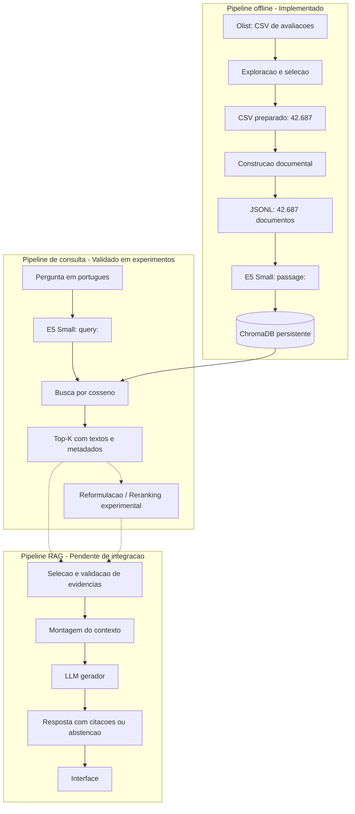

# Arquitetura Tecnica - Voice of Customer Intelligence com RAG

**Versao:** 0.1.0

**Data da revisao:** 04/11/2026

**Estado:** infraestrutura de dados e recuperacao implementada;
integracao generativa pendente.

## 1. Visao geral

A arquitetura utiliza um pipeline offline para preparar as
avaliacoes e construir o indice vetorial e um fluxo de consulta
para recuperar comentarios semanticamente relevantes.

A solucao foi organizada para permitir a integracao posterior
de um LLM, controles de evidencias e interface de usuario.

## 2. Diagrama da arquitetura atual

As linhas continuas representam componentes implementados e
executados. As conexoes tracejadas representam integracoes
planejadas ou experimentais.

## 3. Pipeline offline

### 3.1 Exploracao dos dados

Arquivo: `scripts/explorar_avaliacoes.py`

Entrada:
`data/raw/olist_order_reviews_dataset.csv`

Saida:
`data/processed/reviews_preparadas.csv`

Responsabilidades:
- Identificar registros com conteudo textual.
- Preservar os campos originais necessarios.
- Criar identificadores tecnicos.
- Produzir relatorio agregado de qualidade.

Resultado: 42.687 registros aproveitaveis.

### 3.2 Construcao dos documentos

Arquivos:
- `src/preprocessing/documentos.py`
- `scripts/construir_base.py`

Entrada:
`data/processed/reviews_preparadas.csv`

Saida:
`data/processed/reviews_documentos.jsonl`

Cada documento contem:

- `id`: identificador tecnico.
- `page_content`: titulo e/ou comentario.
- `metadata`: informacoes de origem e caracteristicas.

Metadados preservados:
- document_id
- review_id
- order_id
- review_score
- review_creation_date
- tipo_texto
- fonte
- n_palavras
- hash_texto

Decisoes:
- Um documento por avaliacao textual.
- Sem chunking inicialmente.
- Sem remocao automatica de textos repetidos.
- Preservacao de negacoes e informacoes relevantes.

Resultado: 42.687 documentos.

### 3.3 Geracao de embeddings

Modelo:
`intfloat/multilingual-e5-small`

Configuracao:
- 384 dimensoes.
- Prefixo `passage:` nos documentos.
- Prefixo `query:` nas perguntas.
- Embeddings normalizados.

A geracao de embeddings transforma textos em vetores
numericos para comparacao semantica.

### 3.4 Indexacao vetorial

Arquivo:
`scripts/indexar_base_completa.py`

Banco:
ChromaDB.

Colecao:
`olist_e5_full_42687_v1`

Configuracao:
- Cliente persistente local.
- Distancia de cosseno.
- Insercao em lotes de 128 documentos.
- Inferencia em lotes de 32 textos.
- Processamento incremental.
- Verificacao de identificadores.
- Assinatura SHA-256 do arquivo de origem.

Resultado: 42.687 documentos indexados.

O indice completo e mantido em:

`data/vectorstore/chroma_e5_completo/`

Essa pasta e local e nao e versionada no Git.

## 4. Pipeline de consulta implementado

Fluxo de um experimento:

1. Receber pergunta em portugues.
2. Adicionar prefixo `query:`.
3. Gerar vetor da pergunta com o modelo E5.
4. Consultar o ChromaDB por similaridade de cosseno.
5. Recuperar comentarios e metadados.
6. Ordenar os candidatos pela proximidade vetorial.
7. Exibir evidencias para inspecao.

Arquivos:
- `scripts/testar_embeddings.py`
- `scripts/testar_chromadb.py`
- `scripts/auditar_recuperacao.py`
- `scripts/testar_reranker.py`

### 4.1 Reformulacao de perguntas

Foi observado que consultas mais especificas podem
recuperar comentarios mais pertinentes.

Entretanto, a reformulacao pode restringir o significado
original da pergunta, devendo ser avaliada cuidadosamente.

### 4.2 Reranking

Modelo experimental:
`cross-encoder/mmarco-mMiniLMv2-L12-H384-v1`

Estrategia avaliada:
- Recuperar Top-50 pelo E5.
- Reordenar candidatos com cross-encoder.
- Comparar Top-8 antes e depois.

O reranker melhorou uma consulta sobre qualidade,
mas reduziu a precisao observada em sua versao reformulada.

Portanto, nao foi adotado como padrao definitivo.

## 5. Fluxo generativo planejado

A proxima evolucao devera:

1. Receber e validar uma pergunta.
2. Identificar se esta no escopo das avaliacoes.
3. Recuperar comentarios relevantes.
4. Selecionar evidencias sem repeticoes desnecessarias.
5. Verificar pertinencia e suficiencia das evidencias.
6. Construir contexto com identificadores de fonte.
7. Enviar pergunta e contexto ao LLM.
8. Gerar resposta restrita as informacoes sustentadas.
9. Exibir os documentos usados como evidencia.
10. Abster-se quando nao houver suporte suficiente.

O LLM ainda nao foi escolhido e validado.

A interface de usuario ainda nao foi implementada.

## 6. Rastreabilidade

A rastreabilidade deve utilizar preferencialmente:

- Identificador tecnico do documento.
- Identificador original da avaliacao.
- Identificador do pedido.
- Nota da avaliacao.
- Data da avaliacao.
- Texto recuperado.

Os documentos poderao ser identificados no contexto
por marcadores como F1, F2 e F3.

Esses marcadores deverao corresponder a documentos reais
e permitir verificar as informacoes apresentadas ao usuario.

## 7. Limitacoes conhecidas

### Representatividade

A base textual contem 42.687 de 99.224 avaliacoes.
Ela nao representa automaticamente a distribuicao
de todos os registros originais.

### Textos curtos e repetidos

Existem 5.778 documentos com ate tres palavras e
5.975 ocorrencias adicionais de textos repetidos.

Os registros originais foram preservados.

### Similaridade e intencao

A proximidade vetorial pode recuperar comentarios
sobre o mesmo tema, mas com significado ou polaridade
inadequados para a pergunta.

### Frequencia de reclamacoes

Os resultados Top-K de uma busca vetorial nao
comprovam frequencias globais.

Perguntas quantitativas exigirao contagem sobre
um conjunto adequadamente classificado ou filtrado.

### Evidencias insuficientes

A deteccao de ausencia de evidencias ainda sera
implementada no pipeline generativo.

## 8. Organizacao e versionamento

Codigo, documentacao, testes e relatorios agregados
serao versionados no GitHub.

Arquivos nao versionados:
- Dados brutos.
- CSVs preparados.
- Documentos JSONL com comentarios.
- Bancos vetoriais locais.
- Credenciais e variaveis de ambiente sensiveis.

O repositorio devera fornecer instrucoes para reconstruir
o pipeline a partir do dataset oficial.

## 9. Etapas seguintes

### Obrigatorias

1. Integrar recuperacao e montagem de contexto.
2. Escolher e integrar o LLM.
3. Implementar citacoes e verificacao de evidencias.
4. Implementar tratamento de perguntas fora do escopo.
5. Implementar abstencao por insuficiencia de informacao.
6. Avaliar relevancia e fidelidade das respostas.
7. Construir interface de demonstracao.
8. Preparar documentacao final e video.

### Complementares

- Recuperacao hibrida.
- Classificacao tematica e analise de frequencia.
- Integracao de dados de pedidos e produtos.
- Filtros por atributos de pedidos e avaliacoes.

## 10. Decisoes tecnicas

As justificativas, alternativas e limitacoes
estao registradas em `docs/decisoes.md`.

Esse arquivo devera ser atualizado sempre que
uma decisao relevante for tomada ou revisada.
