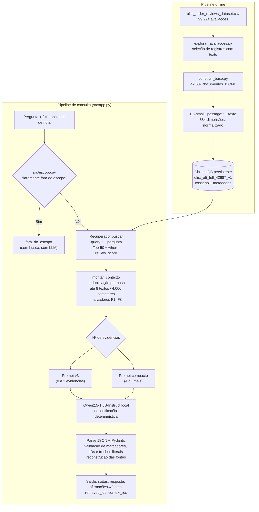

# Arquitetura Técnica — Voice of Customer Intelligence com RAG

**Versão:** 1.0.0 (entrega final)
**Data da revisão:** 16/11/2026
**Estado:** pipeline completo implementado e executado ponta a ponta sobre o índice de 42.687 documentos; avaliação dos 18 casos de desenvolvimento registrada em [`reports/avaliacao_p4_desenvolvimento.md`](../reports/avaliacao_p4_desenvolvimento.md).

## 1. Visão geral

A solução tem dois fluxos:

- **Pipeline offline** — transforma o CSV de avaliações da Olist em documentos rastreáveis, gera embeddings e persiste o índice vetorial. Executado uma vez por máquina.
- **Pipeline de consulta** — recebe a pergunta, faz a triagem de escopo, recupera avaliações semelhantes (com filtro opcional por nota), monta o contexto, gera a resposta com um LLM local e valida estrutura e citações antes de devolvê-la.

Tudo roda localmente, em CPU, sem chave de API.

## 2. Diagrama



## 3. Pipeline offline

| Etapa | Arquivo | Entrada → Saída | Decisões |
|---|---|---|---|
| Seleção | `scripts/explorar_avaliacoes.py` | CSV bruto → `reviews_preparadas.csv` (42.687) | D001, D004 |
| Documentos | `src/preprocessing/documentos.py`, `scripts/construir_base.py` | CSV preparado → `reviews_documentos.jsonl` | D002, D005, D006 |
| Embeddings | `scripts/indexar_base_completa.py` | JSONL → vetores E5 (`passage:`) | D007 |
| Indexação | `scripts/indexar_base_completa.py` | vetores + metadados → ChromaDB | D008, D009 |

**Documento:** um por avaliação, sem chunking (mediana de 10 palavras, máximo de 50). Campos: `id`, `page_content` (título e/ou comentário) e `metadata` com `document_id`, `review_id`, `order_id`, `review_score`, `review_creation_date`, `tipo_texto`, `fonte`, `n_palavras`, `hash_texto`.

**Limpeza:** apenas normalização de espaços e caracteres de controle. Acentos, pontuação, negações e textos repetidos são preservados (o texto original é a evidência citada).

**Valores ausentes:** avaliações sem título e sem comentário (56.537) ficam fora do índice, porque não têm conteúdo textual a recuperar. Título ausente ou comentário ausente não descartam o registro.

**Reprodutibilidade:** o JSONL gerado é determinístico; seu SHA-256 (`3519b8a9…`) está registrado em `evaluation/manifesto_congelado.json` e é conferido por `scripts/auditar_avaliacao_p1.py`. A indexação é incremental, verifica IDs e guarda a assinatura da origem nos metadados da coleção.

## 4. Pipeline de consulta

| Passo | Componente | Comportamento |
|---|---|---|
| 1. Validação | `src/app.py` | Pergunta vazia → `erro_operacional`. |
| 2. Triagem de escopo | `src/escopo.py` | Regras conservadoras para pedidos claramente externos (capital, receita, orientação médica…). Bloqueia sem buscar e sem chamar o LLM. Perguntas ambíguas seguem adiante. |
| 3. Transformação da pergunta | `Recuperador.buscar` | Prefixo `query:` do E5, embedding normalizado. Em `extrair_tarefa_legitima`, comandos explícitos de sobrescrita ("ignore as instruções…") são removidos antes do prompt. |
| 4. Recuperação | `src/retrieval/recuperador.py` | Top-50 por similaridade de cosseno no ChromaDB. Filtro opcional `nota_min`/`nota_max` aplicado como `where` antes do ranking (D027). |
| 5. Seleção do contexto | `src/retrieval/contexto.py` | Descarta duplicatas por `hash_texto`, limita a 8 textos e 4.000 caracteres, atribui marcadores F1…F8. Sem candidatos → `evidencias_insuficientes` sem chamar o LLM. |
| 6. Prompt | `construir_prompt` em `src/generation/resposta.py` | Instruções na mensagem de sistema; pergunta e evidências em JSON na mensagem do usuário, tratadas como dados não confiáveis. Prompt v3 (≤ 3 evidências) ou compacto (≥ 4) — D026. |
| 7. Geração | `src/generation/modelo.py` | Qwen2.5-1.5B-Instruct, `do_sample=False`, até 600 tokens novos; registra motivo de parada. |
| 8. Validação | `gerar_resposta`, `validar_citacoes` | JSON → Pydantic; cada marcador, `document_id` e trecho deve existir literalmente no contexto; `respondida` exige afirmações com fonte. Falha → `erro_operacional` (nunca é confundida com falta de evidências). |
| 9. Saída | `src/app.py` | Contrato abaixo. |

### 4.1 Contrato de saída

```json
{
  "status": "respondida | evidencias_insuficientes | fora_do_escopo | erro_operacional",
  "resposta": "Há relatos de produtos que chegam sem funcionar [F1].",
  "afirmacoes": [{"texto": "Há relatos de produtos que chegam sem funcionar.", "fontes": ["F1"]}],
  "fontes": [{"marcador": "F1", "document_id": "olist_review_row_077709", "trecho": "Comentario: Veio com defeito. Não reconhece em nenhum computador e não funciona."}],
  "retrieved_ids": ["os 50 candidatos recuperados"],
  "context_ids": ["os documentos enviados ao LLM"],
  "filtros": {"nota_max": 2},
  "evidencias_contexto": [{"marcador": "F1", "document_id": "…", "review_score": 1, "similaridade": 0.87}]
}
```

`filtros` e `evidencias_contexto` só aparecem quando um filtro de nota é usado; sem filtro, o contrato é idêntico ao avaliado pela P1.

### 4.2 Rastreabilidade

Cada afirmação aponta para marcadores; cada marcador corresponde a um `document_id` (`olist_review_row_NNNNNN`), que liga ao `review_id` e ao `order_id` originais. O trecho citado é sempre o texto literal da avaliação. `retrieved_ids` e `context_ids` permitem auditar recall e seleção de contexto separadamente.

## 5. Interfaces

- **CLI:** `python -m src.app --pergunta "..." [--nota-min N] [--nota-max N]`.
- **Lote de avaliação:** `python -m src.evaluation.executar_casos` (casos da P1, modos `recuperacao_e_geracao` e `contexto_controlado`).
- **Exemplos reprodutíveis:** `python scripts/gerar_exemplos.py` → `reports/exemplos_respostas.json` (apresentados em [`docs/exemplos.md`](exemplos.md)).

## 6. Parâmetros (`src/config.py`)

| Parâmetro | Valor |
|---|---|
| `MODELO_EMBEDDINGS` | `intfloat/multilingual-e5-small` (384 dim.) |
| `COLECAO_CHROMA` | `olist_e5_full_42687_v1` |
| `TOP_K_CANDIDATOS` | 50 |
| `MAX_DOCUMENTOS_CONTEXTO` | 8 |
| `MAX_CARACTERES_CONTEXTO` | 4.000 |
| `MODELO_GERADOR` | `Qwen/Qwen2.5-1.5B-Instruct` |
| `MAX_TOKENS_SAIDA` | 600 |
| `VERSAO_PROMPT` | `v3-adaptativo-p311` |

## 7. Limitações conhecidas

- **Representatividade:** apenas 42.687 das 99.224 avaliações têm texto; conclusões não se estendem automaticamente a todos os clientes.
- **Frequência:** o Top-K não mede frequência global; o prompt proíbe estimativas de proporção.
- **Similaridade ≠ intenção:** o embedding aproxima temas, mas pode trazer polaridade errada (elogio em pergunta sobre reclamação). O filtro por nota mitiga esse efeito quando o usuário sabe o recorte desejado.
- **Validação estrutural ≠ semântica:** a verificação garante que a fonte existe e que o trecho é literal, não que a fonte sustenta a afirmação. Há casos de citação excessiva (ver relatório de avaliação).
- **Escopo:** as regras cobrem padrões específicos; demais perguntas externas dependem da decisão do LLM.
- **Desempenho:** em CPU, cada pergunta leva da ordem de minutos, tempo dominado pela geração (valores medidos no relatório de avaliação).

## 8. Versionamento

Versionados: código, testes, documentação, benchmark da P1 (perguntas, gabaritos, fixtures, manifesto) e relatórios agregados. Fora do Git: dados brutos, CSV/JSONL processados, índice ChromaDB, modelos baixados e predições locais (`evaluation/resultados_locais/`).

As justificativas, alternativas e limitações de cada escolha estão em [`docs/decisoes.md`](decisoes.md) (D001–D027).
